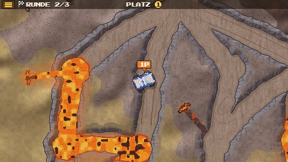

# Testmeldung test_2026-11-19_23-29-34_VULKAN

Man hat keinerlei vorwarnung, ob ein Tunnel befahrbar sein wird. so fühlt sich das unfair an.

## Stand

| Feld | Wert |
|---|---|
| zeit | 2026-11-19T22:29:34.436Z |
| bildschirm | race |
| modus | EINZELSTRECKE |
| build | 398693a |
| fenster | 3127x1163 |
| strecke | VULKAN (rev 6) |
| schwierigkeit | SCHWER |
| runde | 2/3 |
| platz | 1/4 |
| auto | POLIZEI |
| rennzeit | 72.2 s (race) |
| ereignisse | ausbruch, lavastrom, brueckenloch |

## Autos

| nr | auto | ich | x | y | winkel | tempo | runde | punkt | platz | fertig | dreck | boden | off |
|---|---|---|---|---|---|---|---|---|---|---|---|---|---|
| 1 | POLIZEI | ja | 244 | 476 | -741 | 1 | 2 | 1835 | 1 |  | 0.4 | 1 | 10.3 |
| 2 | FLITZER |  | 711 | 390 | -534 | 99 | 2 | 1523 | 3 |  | 0.6 | 1 | 4.6 |
| 3 | MONSTER |  | 845 | 395 | -531 | 103 | 2 | 1455 | 4 |  | 0.6 | 1 | 17.6 |
| 4 | TRAKTOR |  | 338 | 290 | -589 | 117 | 2 | 1726 | 2 |  | 0.4 | 1 | 12 |

