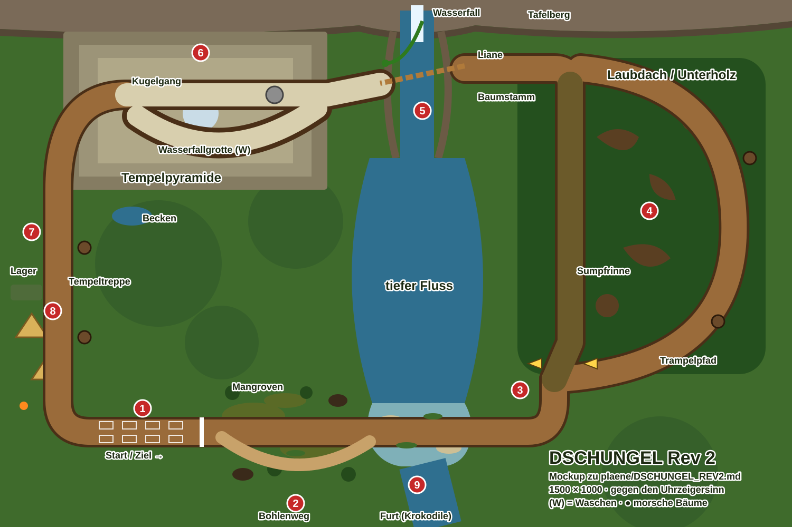

# DSCHUNGEL Rev 2 – Umsetzungsplan

Stand: 2026-10-31, Branch `map_pack`. Eigener Plan für den Komplettumbau der Dschungelstrecke (Strecke 11, Cup 4). Er steht bewusst nicht in `ROADMAP.md` (`Obsidian/Mudracer/ROADMAP.md`); dort bleibt nur der Block `1S11` mit einem Verweis hierher. Grundlage: Prototyp in `src/jungle.js` und `src/junglemap.js`, `Strecken.md` Abschnitt 11, ROADMAP 1S11-1 bis 1S11-8, Skills `strecke` und `mechanik`, Streckendesign-Grundsätze in `CLAUDE.md`. Gemeinsamer Rahmen (Lehren, Reihenfolge, Codes): `plaene/REWORKS_CUP4_CUP5.md`. Vorbild für Aufbau und Ablauf: `plaene/EIS_REV2.md`, `plaene/WUESTE_REV3.md`, `plaene/VULKAN_REV2.md` (Branch `vulkan_rev2`).

**Status je Paket** wird hier gepflegt (Abschnitt „Arbeitspakete“). Erst beim Abschluss (J8) wird `ROADMAP.md` nachgezogen: 1S11 auf den neuen Stand, Tabelle „Strecken im Überblick“, 1A-4, 1A-7, 1P-1, 1P-2.

Grobes Mockup von Claude (2026-10-31, ersetzt kein Mockup des Nutzers): [mockups/DSCHUNGEL_REV2.svg](mockups/DSCHUNGEL_REV2.svg)



## Ziel in einem Satz

Der Dschungel wird zur Expedition durch ein Flusstal: vom Lager durch den Mangrovensumpf, quer durch die Furt mit Krokodilen, unter dem dichten Laubdach hinauf, an der Lianenschlucht unter dem Wasserfall über den Fluss und durch eine dunkle Tempelpyramide, in der ab Runde 2 eine Steinkugel rollt, die Tempeltreppe hinunter zurück ins Lager.

## Ausgangslage (Prototyp)

- 800×450, ein Rechteck mit runden Ecken (`poly` mit fünf Punkten), Runde etwa 20 s. Start in der Kurve (90°, 1A-4, 1S11-3).
- Vorhanden und brauchbar: Laubdach mit Loch um das eigene Auto (`canopy`), Liane als Pendel über die Schlucht mit Baumstamm daneben (`gorge`), Tempelgang mit Halle (`temple`, `hall`), Furt mit Schub (`ford`), Bohlenweg (`boardwalk`), tiefer Sumpf (`quick`, Code 10), morsche Bäume, die als kleine Schanze liegen bleiben, Steinkugel ab Runde 2, Krokodile, Papageien, Lager, Steinköpfe; Lied `jungle`.
- Schwach (Roadmap): offener Waldboden im Innenfeld als Abkürzung (1S11-1), Gabelung unter dem Laubdach zum Raten (1S11-2), Sumpf als Stempel über die ganze Breite (1S11-4), Furt als Rechteck, gerade Schluchtufer, Kugel verschwindet (1S11-5), zu viel auf einer Stelle unten rechts (1S11-6), Affen, Nebel, Glühwürmchen fehlen (1S11-7), Krokodile und Kugel zu harmlos (1S11-8). Kein erkennbares Wasch-Konzept (Grundsatz 13).

## Entscheidungen (Vorschlag, vom Nutzer zu bestätigen)

| Frage | Vorschlag |
|---|---|
| Umfang | **Kompletter Umbau** wie Wüste, Eis, Vulkan: das Flusstal bestimmt die Strecke. Bausteine des Prototyps werden wiederverwendet (Laubdach, Liane, Baumstamm, Steinkugel, morsche Bäume, Krokodile, Papageien, Lager, Steinköpfe, Farben) |
| Kartengröße | **1500 × 1000** (1,5 Mpx, quer). Kleiner als der Vulkan (1,76 Mpx), damit die Bauzeit unter der der Wüste bleibt |
| Rundenzeit | Ziel **40–45 s** (Vulkan 31–37 s mit dem Bot) |
| Fluss | **Ein** Fluss: kommt als Wasserfall vom Tafelberg am Nordrand, läuft durch eine Schlucht, wird in der Mitte breit und tief (natürliche Sperre gegen Abkürzungen durch die Mitte, Grundsatz 4), weitet sich unten zur Furt und fließt am Südrand hinaus (Grundsatz 2) |
| Waschen | **Wasserfall in der Tempelhalle** (Grundsatz 13): Wasser fällt durch ein Loch im Dach, ein Zweig der Halle führt hindurch. Die Furt ist trübes Flusswasser und **wäscht nicht** (eigener Code 91), sonst gäbe es zwei Konzepte |
| Ereignisse | `baeume` (morsche Bäume, liegen danach als Schanze, ab Runde 2 öfter), `kroko` (Furt und Sumpf), **neu `steinkugel`** (bisher an `baeume` gehängt, eigener Schalter, ab Runde 2). Alle drei räumlich getrennt |
| Gabelungen | **Zwei**: (1) vor dem Laubdach: Sumpfrinne durchs Unterholz (kurz, Matsch, Wurzeln) oder Trampelpfad (lang, trocken); (2) in der Tempelhalle: Kugelgang (kurz, ab Runde 2 die Kugel) oder Wasserfallgrotte (länger, wäscht, sicher). Dazu die Wahl Liane oder Baumstamm |
| Name, Rekorde | Name `DSCHUNGEL` bleibt, `rev: 2`. Lied `jungle` bleibt, Schichten an die Runden |

### Offene Fragen an den Nutzer

1. Gibt es ein Mockup (`Screenshots/DSCHUNGEL_improvements.jpg`)? Dann gehen Grundriss und Elemente danach.
2. Quer (1500×1000) oder hochkant wie EIS (der Fluss könnte von oben nach unten durch die ganze Karte laufen)?
3. Liane behalten (Zufall: hängt sie auf meiner Seite?) oder durch einen festen Sprung ersetzen? Vorschlag: behalten, aber das Pendel sieht man von weitem (Schatten auf dem Boden), damit es keine reine Glückssache ist.
4. Steinkugel als eigener Schalter `steinkugel` (Vorschlag) oder weiter Teil von `baeume`?
5. Soll in der letzten Runde ein Monsunregen den Fluss steigen lassen (Furt tiefer, Sumpf breiter)? Vorschlag: nein, wegen Grundsatz 9; höchstens als Optik (Regen ohne Wirkung).

## Grundriss

```
 x:  0        250       500       750       1000      1250     1500
 y ┌───────────────────────────────────────────────────────────────┐
  0 │ ▓▓▓▓▓▓▓▓▓▓▓▓▓ TAFELBERG ▓▓▓▓▓▓▓ (W)Wasserfall ▓▓▓▓▓▓▓▓▓▓▓▓▓▓▓▓▓ │
    │   ╭────── TEMPELPYRAMIDE ──────╮  ║(5)Schlucht ╭────────────╮   │
150 │   │ (6)Halle ─┬─ Kugelgang ────┼◄═╬═ Liane ═══╡  Laubdach   │   │
    │   │           └─ Grotte (W) ───┤  ║  Stamm     │  (4) Unter- │   │
300 │   ╰────╮ (7) Tempeltreppe ╭────╯  ║            │  holz-Feld  │   │
    │        ▼  morsche Bäume   │      ≈≈≈           │  Würgefeigen│   │
500 │   (8)  │                  │    ≈≈≈≈≈ tief      ╰─┬────────┬─╯   │
    │  Lager │  Steinköpfe      │    ≈≈≈≈≈ Fluss  (3) Gabel: Sumpf-  │
700 │        ╰──╮               │     ≈≈≈         rinne │ Trampelpfad│
    │  🏁 Start ═(1)═ Mangroven/Bohlenweg (2) ═══ FURT (9) ═══╯       │
900 │                                   ≈≈ Fluss zum Südrand          │
1000└───────────────────────────────────────────────────────────────┘
```

Fahrtrichtung: Start unten links nach Osten (1), Mangrovensumpf mit Bohlenweg (2), quer durch die Furt (9), auf der Ostseite nach Norden zur Gabelung (3) und unter das Laubdach (4), oben nach Westen an die Schlucht unter dem Wasserfall (5), mit der Liane oder über den Baumstamm, in die Tempelpyramide (6) mit der zweiten Gabelung, die Tempeltreppe (7) hinunter, am Lager (8) vorbei auf die Startgerade. Das ist gegen den Uhrzeigersinn; die Startaufstellung liegt auf der Geraden y ≈ 820 vor der Linie (Fahrt nach Osten, Grundsatz 5).

Richtwerte (in J1 festlegen, danach nur noch hier ändern):

| Stelle | Richtwert (Spielpixel) |
|---|---|
| Karte | 1500 × 1000 |
| Startlinie / Aufstellung | Linie (380, 820), Aufstellung x 150–360, Fahrt nach Osten |
| Mangroven, Bohlenweg (2) | x 420–700, y 760–900; Bohlenweg als Bogen nach Süden (y ≈ 880) |
| Furt (9) | Fluss bei x 720–860, y 780–870, flach mit zwei Kiesbänken; unterhalb y 880 tief |
| Fluss Mitte | x 680–900, y 300–760, tief, Ufer mit Schilf und Wurzeln, keine Brücke |
| Gabelung (3) | (1050, 720); Sumpfrinne gerade nach Norden x ≈ 1080, Trampelpfad als Bogen nach Osten bis x ≈ 1380 |
| Laubdach / Unterholz (4) | x 980–1440, y 120–700 |
| Schlucht (5) | x 720–860, y 80–300; Wasserfall bei (790, 20) |
| Tempelpyramide (6) | x 120–620, y 60–360; Halle bei (380, 200); Gabel in der Halle |
| Tempeltreppe (7) | x 140–220, y 360–700, bergab (Schub) |
| Lager (8) | x 20–140, y 520–760 |

Rundenzeit-Schätzung: Startgerade und Sumpf 6 s, Furt 4 s, Gabel und Unterholz 9 s, Schlucht 3 s, Tempel 10 s, Treppe 5 s, Lager und Kurve 4 s ≈ **41 s**.

## Die Elemente

| # | Element | Umsetzung |
|---|---|---|
| 1 | **Startgerade** | Erdweg (Code 1, Farbe aus `THEMES.dschungel`), dunkler und feucht; Fähnchen der Expedition über der Linie. Gerade lang genug für fünf Reihen (220 px), Startplätze ohne Sumpf und ohne Baum (1S11-3) |
| 2 | **Mangrovensumpf und Bohlenweg** | Sumpf (Code 2, grüner Schmutz `goo`) wächst vom Rand her in die Fahrbahn, als Senken zwischen Mangroven-Wurzeln (fest), nie über die ganze Breite (1S11-4, Grundsatz 3). Die direkte Linie geht durch Sumpf; der **Bohlenweg** (neu Code 92, Holz, volle Haftung, klappert) ist ein längerer Bogen nach Süden, schmal (halbe Breite 12), ohne Geländer: wer abrutscht, landet im Sumpf (kein Fall). Zwei Stellen tiefer Sumpf (Code 10, Sog wie Treibsand, schwächer) liegen klar abseits der Linie und blubbern (Grundsatz 12) |
| 3 | **Gabelung vor dem Laubdach** | Liegt **vor** dem Rand des Laubdachs auf einer kleinen Lichtung (1S11-2), mit zwei großen Expeditions-Wegweisern (Pfeil, Totenkopf für die Sumpfrinne, Zelt für den Pfad; Stil der Wüsten-Schilder 1S8-18). Sumpfrinne: kurz, Matsch und Wurzelbuckel (Ruckeln), führt direkt durchs Unterholz. Trampelpfad: lang, trocken, schmaler Erdweg mit Kurven am Ostrand. Beide treffen sich am Nordrand des Laubdachs |
| 4 | **Unterholz unter dem Laubdach** | Offenes Feld wie der Eiswald: neuer **Code 90 Waldboden** (etwa .85 der Straße, Haftung normal, macht nicht schmutzig), `T.alt`, Hook `wander`. Würgefeigen, Wurzelwände und Felsblöcke als **zusammenhängende Wand-Form** (geglättete Abstandsfunktion, Kreise folgen dem Umriss, 1S9-9), dazwischen gewundene Gassen mit S-Kurven (1S11-1). Riesenfarne als Deko (überfahrbar, flach und blass, Grundsatz 10). Das Laubdach liegt darüber: Kronen im `top`-Bild, um das eigene Auto ein Loch (Radius etwa 70 px, weicher Rand) wie heute; dazu Lichtflecken, die durchs Laub fallen, Glühwürmchen (1S11-7). Feste Gassenbreite mindestens 56 px; die Mittellinie ist immer eine fahrbare Gasse (Poisson wie die Pinien, mit freier Gasse) |
| 5 | **Lianenschlucht unter dem Wasserfall** | Der Fluss kommt als **Wasserfall** vom Tafelberg (Gischt, Regenbogen in der Gischt, Rauschen) und läuft durch eine Schlucht mit Felsufern, die dem Fluss folgen (1S11-5, nicht gerade). Quer darüber: die **Liane** (Pendel, 3 s je Schwung, wie heute; ihr Schatten zeigt schon von weitem, wo sie gerade ist) oder der **Baumstamm** daneben (ein Auto breit, wer ihn verfehlt, fällt in die Schlucht: `fallCar 'abyss'`, wird vom Fluss ein Stück abgetrieben gezeichnet und **hinter** der Schlucht abgesetzt, nicht davor; Rückkehrpunkt im Sprung `land`). Kein Dreher nach dem Lianenschwung (1S8-12) |
| 6 | **Tempelpyramide** | Stufenpyramide (Maya-Stil) aus großen Steinblöcken, außen Moos, Wurzeln, Steinköpfe, Treppe in der Mitte. Innen **dunkel** über die Lichtkarte (Wüste), Fackeln an den Wänden mit Abstand, Lampen an allen Autos. Straße aus hellen Steinplatten mit Randsteinen, im Dunkeln lesbar (Kontrast). In der **Halle** (Säulen, Schatztruhe als Optik) die zweite Gabelung: **Kugelgang** (kurz, gerade, leicht bergab) oder **Wasserfallgrotte** (Bogen um die Halle, Lichtstrahl und Wasser durch ein Loch im Dach, wäscht, siehe Waschen). Eine feste Säulenreihe trennt die Zweige (Wand wie in der Pyramide der Wüste) |
| 7 | **Tempeltreppe hinunter** | Breite Steintreppe nach Süden, Gefälle als Schub (`pushes`, etwa +24), Stufen als leichtes Ruckeln. Links und rechts der Treppe **morsche Bäume** (Ereignis `baeume`) |
| 8 | **Lager** | Expeditionslager links (Zelte, Jeep, Kisten, Lagerfeuer mit Rauch, Funkmast, Hängematte), rein optisch, abseits der Fahrbahn. Der Forscher mit Tropenhelm rennt bei der Steinkugel weg (Gag, nur im Sichtfeld) |
| 9 | **Furt mit Krokodilen** | Flussverbreiterung mit zwei Kiesbänken (Straße) und flachem, trübem Wasser (neu **Code 91 Furtwasser**: wie flaches Wasser .72, Strömung nach Süden über `pushes {rect, fx, fy}`, **wäscht nicht**, macht leicht grün). Wer zu weit abtreibt, kommt ins tiefe Wasser (Code 5, Versinken, Rückkehr vor der Furt). Steine und Treibholz in der Furt sind fest und in `T.ev.obst`. Die Ufer laufen weich aus (Grundsatz 3) |
| 10 | **Kulisse** | Affen in den Kronen am Rand (winken, schwingen, rein optisch, 1S11-7), Papageien fliegen auf, wenn ein Auto vorbeifährt (vorhanden), Schmetterlinge, Nebelschwaden über dem Sumpf (verdecken nur Sumpf, nie die Ziellinie, Grundsatz 14), Steinköpfe am Kartenrand, Tukan auf dem Wegweiser |

Bleibt aus dem Prototyp: Laubdach-Loch, Liane und Baumstamm (neu platziert), morsche Bäume als Schanze, Steinkugel (schärfer), Krokodile (schärfer), Papageien, Lager, Steinköpfe, Farben, Lied.
Entfällt: Rechteck-Kurs (`poly`), Innenfeld-Waldboden (1S11-1), die Gabelung unter dem Dach (`detour`), die Rechteck-Furt, die geraden Schluchtufer, der Baum am Start (60, 196), die Häufung unten rechts (1S11-6).

## Waschen (Grundsatz 13)

Nur die **Wasserfallgrotte** in der Tempelhalle. Sie ist der längere Zweig der Halle (etwa 1,5 s Umweg), wäscht nicht sofort (wie `washMask`: −.35 beim Einfahren, dann −3/s), kündigt sich an (Rauschen, Lichtstrahl schon im Gang sichtbar, Gischt). Die KI nimmt sie nur dreckig (Schwellen .4 / .55 / .7), sonst den Kugelgang; ab Runde 2 nehmen ängstliche Autos (LEICHT) die Grotte auch sauber, wenn die Kugel bereit ist. Die Furt (Code 91) und der Fluss waschen nicht; der Sumpf macht grün.

## Ereignisse

| Schlüssel | Ablauf | Ankündigung | Ort |
|---|---|---|---|
| `baeume` | Vier morsche Bäume an Treppe und Trampelpfad. Runde 1: einer alle 18–24 s, Runde 2: alle 12–16 s, Runde 3: alle 8–12 s (wie der Schneeball, `lapK`). Der Stamm bleibt liegen und ist eine kleine Schanze (schnell: Hüpfer, langsam: holpert und bremst stark). Nie zwei Stämme näher als 80 px auf der Linie; ein fünfter fällt nicht auf einen liegenden | Knarren, Blätter rieseln, Schatten wandert über die Straße, **Warndreieck** am Bildrand über der Stelle (kein Text), 1,8 s vorher | Treppe, Trampelpfad (nicht unter dem Laubdach, nicht im Tempel) |
| `kroko` | Krokodile liegen wie Stämme in Furt und Sumpf, tauchen auf und **schnappen**: Treffer `stun` 1,2 s und Tempo halbiert (schärfer, 1S11-8). Ab Runde 2 schwimmt eins quer durch die Furt. Nie im Takt eines anderen Ereignisses (1S11-6) | Augen und Blasen 1 s vorher, Maul öffnet sich langsam | Furt, Mangroven |
| `steinkugel` (neu) | Ab Runde 2 im Kugelgang: wer als Erster die Halle betritt, hört ein Klicken, Staub fällt von der Decke, die Kugel rollt hinter ihm her (etwa 90 % Höchsttempo eines mittleren Autos). Wer überrollt wird, ist **1,2 s platt** und verliert Tempo (schärfer, 1S11-8). Am Ende des Gangs **rollt sie in ein Wasserbecken unter der Treppe** und versinkt mit Fontäne (1S11-5); danach 15 s, bis sie wieder oben ist (sichtbar am Seil, das sie hochzieht). In der letzten Runde zwei Kugeln kurz nacheinander | Klicken, Staub, Rumpeln, Paukenwirbel im Lied, Warndreieck am Bildrand im Gang | nur Kugelgang |

Alle drei Schalter in `PREFS.events` (`state.js`, `steinkugel` neu, Standard an), `FX_NAMES` (`raceopts.js`), Hook `events` in `jungle.js`. `T.ev`-Felder beginnen mit `jg` (`jgTrees`, `jgCrocs`, `jgBall` …); heute heißen sie `trees`, `crocs`, `ball`, `logs` (T22, `checkAll` meldet allgemeine Namen) und werden mit J1 umbenannt.

## Lied `jungle`

Schichten an den Runden statt Wechsel (1M-1):
- Runde 1: Bongos, Congas, Shaker, Holzflöte mit Luftrauschen, weicher Bass.
- Runde 2: Marimba-Arpeggios und die „Dschungel als Rhythmus“-Schicht (Frösche als Rimshot, Vogelpfiffe als Antwort, Grillen).
- Letzte Runde: Taiko und Gong auf jeder Eins.
- Im Tempel: Filter zu, Hall, nur Trommel und Bordun (wie in der Pyramide der Wüste).
- Paukenwirbel vor der Steinkugel.

Neue Töne: Wasserfall-Rauschen (nur in der Nähe), Bohlen-Klappern, Klicken und Staub (Kugel), Kugel versinkt, Affenrufe.

## Performance (Pflicht, ROADMAP 1P-1)

Bau (Ziel unter 1 s, nie langsamer als die Wüste):
- Jede Pixel-Schleife nur über das Rechteck ihres Elements (Unterholz, Tempel, Fluss, Sumpf), mit `yield` in Häppchen.
- Würgefeigen-Wände über die gemeinsame Abstandsfunktion (Rechteck des Laubdachs, nicht ganze Karte), Rauschen grob (jede 4. Zeile/Spalte).
- Kronen des Laubdachs als eigenes Bild nur in der Größe des Laubdachs (etwa 460 × 580), nicht als Teil eines Vollbilds.
- Flussufer und Wasser aus `def.rivers` (vorhanden), Strömung als `pushes`-Rechteck.

Laufzeit:
- Laubdach-Loch: ein Sprite (weicher Kreis) mit `destination-out` auf einer Sicht-großen Kopie des Laubs, einmal je Frame; heute prüfen, wie `jungle.js` das macht, und nur im Sichtfeld zeichnen.
- Lichtkarte nur, wenn der Spieler im Tempel ist (wie `T.desert.inside`).
- `T.ev.obst`: Würgefeigen nur nahe KI-Autos (Raster), Treibholz, Krokodile beim Schnappen, Kugel.
- Affen, Papageien, Schmetterlinge, Glühwürmchen, Wasserfall-Gischt nur im Sichtfeld (`inView`), Glühwürmchen höchstens 30.
- Messen in J8: Bauzeit (`mudracer.perf`, `check`), Frame-Zeit mit 10 Autos unter dem Laubdach und im Tempel mit Kugel, Mobilgröße.

## Technik

- **`TRACK_DEFS`**: `rev: 2`, `W: 1500`, `H: 1000`, neue `poly`, `events: ['baeume', 'kroko', 'steinkugel']`; Felder `river` (eine Kette vom Wasserfall bis zum Südrand), `falls`, `gorge` (Liane, Stamm), `swamp` (Senken), `boards` (Bohlenweg), `fords`, `fork1` (Sumpfrinne/Pfad), `canopy` (Polygon), `field` (Unterholz), `walls` (Würgefeigen, Felsblöcke), `temple` (Fußabdruck, Halle, `fork2`, Grotte, Kugelgang, Becken), `stairs`, `camp`, `heads`, `monkeys`, `signs`. Entfallen: `detour`, `ford.rect` (Rechteck), `boardwalk` alt, `trees` am Start, `hall` alt.
- **Boden-Codes** 90 Waldboden, 91 Furtwasser, 92 Bohlen; Hook `surf`, Liste über `surfOf`, Skills `mechanik` und `strecke`.
- **Dateien**: `src/junglemap.js` (Gelände und Bild neu), `src/jungle.js` (Laufzeit: Laubdach, Liane, Lichtkarte im Tempel, Ereignisse, KI-Hooks), `src/tracks.js` (`TRACK_DEFS`, `THEMES.dschungel`), `src/state.js`, `src/raceopts.js` (`steinkugel`), `src/audio.js`, `src/music.js`; gemeinsamer Baukasten (`plaene/REWORKS_CUP4_CUP5.md`, J1).
- **Fortschritt**: Hook `progress` (Unterholz-Feld neben dem Trampelpfad, Tempel-Zweige, Treppe neben dem Lager); Checkpoints nicht in Gabelungen und nicht auf dem Baumstamm.
- **KI**:
  - Gabelung 1: Autos mit `mud ≥ 1.15` und SCHWER nehmen die Sumpfrinne, sonst den Pfad (Hook `target`, wie Vulkan an der Gabel).
  - Unterholz: breit fahren (Hook `wander`), Wände über `T.ev.obst`; unter dem Laubdach auf LEICHT langsamer (Hook `throttle`, wie die Zuckerwatte).
  - Liane: nehmen, wenn sie beim Ankommen auf ihrer Seite ist (Zeit voraus rechnen), sonst Baumstamm mit Gas ≤ .7.
  - Furt: gegen die Strömung halten (Hook `lane`), Krokodile über `T.ev.obst` beim Auftauchen.
  - Tempel: dreckig → Grotte; sonst Kugelgang, vor der Kugel Vollgas (heute: „fliehen nicht extra“).
  - Morsche Stämme: anfahren mit Tempo (Hüpfer), nicht ausweichen.
- **Prüfung**: `check('DSCHUNGEL')` meldet im Unterholz gewollte Linien; im Bericht begründen. `checkSpots` für Krokodile und Liane nach jeder Kursänderung.

## Arbeitspakete

Jedes Paket ist ein Commit (lint, test, typecheck sauber, `check('DSCHUNGEL')` ohne festhängende Autos). Ab J1 ist die Strecke spielbar, `rev: 2` kommt mit J1.

| Paket | Inhalt | Prüfen | Status |
|---|---|---|---|
| J0 Vorbereitung | Vulkan Rev 2 abgenommen und gemergt (1S10-12); gemeinsame Bausteine herausgelöst (1T-13): Abstandsfunktion für Wände, Poisson mit Gasse, Seitenbucht, Lichtkarte, Warndreieck | `check` WUESTE, EIS, VULKAN unverändert | offen |
| J1 Grundriss | Kartengröße, Mittellinie, Startgerade, Fluss vom Wasserfall bis zum Südrand, Tempel-Fußabdruck, Unterholz als Feld (Code 90), Gabelungen als Zweige (noch schlicht), Checkpoints, Hook `progress`, `T.ev`-Namen mit `jg` | `check`: Start gerade, keine ungewollten Abkürzungen (Fluss sperrt die Mitte), 10/10 im Ziel; Bauzeit | offen |
| J2 Sumpf und Furt | Mangroven, Sumpf vom Rand her, tiefer Sumpf abseits, Bohlenweg (Code 92), Furt mit Kiesbänken, Code 91, Strömung, tiefes Wasser unterhalb | `check` LEICHT/SCHWER (Stürze in der Furt?), Screenshot | offen |
| J3 Laubdach und Unterholz | Würgefeigen-Wände aus einem Guss, Gassen, Laubdach mit Loch, Lichtflecken, Glühwürmchen, Gabelung 1 mit Wegweisern, KI-Wahl | `check` alle Stufen, `checkPic`, Frame-Zeit unter dem Dach | offen |
| J4 Schlucht und Wasserfall | Wasserfall mit Gischt, Schluchtufer am Fluss, Liane mit Schatten, Baumstamm, Fall hinter die Schlucht, KI-Wahl | `check`, Stürze am Stamm, Screenshot | offen |
| J5 Tempel | Stufenpyramide, Lichtkarte, Fackeln, Steinplatten, Halle, Gabelung 2, Wasserfallgrotte (Waschen), Treppe mit Gefälle, Becken | `check` alle Stufen, Screenshot innen, Frame-Zeit | offen |
| J6 Ereignisse | `baeume` (Treppe, Pfad, steigend je Runde), `kroko` (schärfer), `steinkugel` (eigener Schalter, Becken, zwei Kugeln in der letzten Runde), Warndreiecke | `check` mit und ohne `fx`, Grundsatz 9 von Hand | offen |
| J7 Kulisse und Lied | Lager mit Forscher, Affen, Papageien, Schmetterlinge, Nebel, Steinköpfe, Tukan; Lied in Schichten, Tempel-Filter, Paukenwirbel; neue Töne | Screenshot, Lied im Spiel anhören (Nutzer) | offen |
| J8 Abschluss | Performance messen, `check` LEICHT/MITTEL/SCHWER mit 3, 5, 10 Autos, Grundsätze 1–14; Doku: `ROADMAP.md` (1S11, Tabelle, 1A-4, 1A-7, 1P-1, 1P-2, „Zuletzt abgeglichen“), `Strecken.md` Abschnitt 11 (Rev 2 oben, Wünsche als umgesetzt markieren), Skills `mechanik` (Codes 90–92, Abschnitt „Dschungel Rev 2 in Kürze“) und `strecke` | alles | offen |

## Grundsätze-Check (für J8)

1. Steigerung: schwerer als VULKAN Rev 2 (Sicht eingeschränkt unter Laubdach und im Tempel, zwei Gabelungen und Liane/Stamm, die Strecke füllt sich mit Stämmen, Kugel jagt), nicht schwerer als WELTALL Rev 2.
2. Nichts Unlogisches: der Fluss kommt vom Wasserfall und fließt zum Südrand, die Schlucht hat Ufer, die Kugel versinkt im Becken, der Bohlenweg führt über Sumpf.
3. Sumpf in Senken zwischen Mangroven, vom Rand her; tiefer Sumpf abseits, blubbert.
4. Keine Abkürzung: der tiefe Fluss sperrt die Mitte, Würgefeigen-Wände im Unterholz, Säulen im Tempel; Wegweiser an der Gabelung.
5. Startaufstellung komplett auf der Geraden unten links.
6. Mehr als ein Kreis: zwei Gabelungen, Liane oder Stamm, Bohlenweg.
7. Ereignisse `baeume`, `kroko`, `steinkugel`, alle ausschaltbar.
8. Eigenes Lied `jungle`.
9. Nicht zu viel auf einmal: Krokodile nur in Furt und Sumpf, Bäume nur an Treppe und Pfad, Kugel nur im Gang; alles mit Ankündigung ohne Text.
10. Würgefeigen und Säulen kräftig mit Schatten, Farne flach und blass; liegende Stämme deutlich als Hindernis.
11. Nicht kindgerecht: platt gewalzt, geschnappt, in die Schlucht gefallen.
12. Sumpfrinne gegen Pfad, Sumpf auf der Ideallinie gegen Bohlenweg.
13. Waschen: nur die Wasserfallgrotte.
14. Kein Nebel, kein Laub über Ziellinie und Aufstellung.
