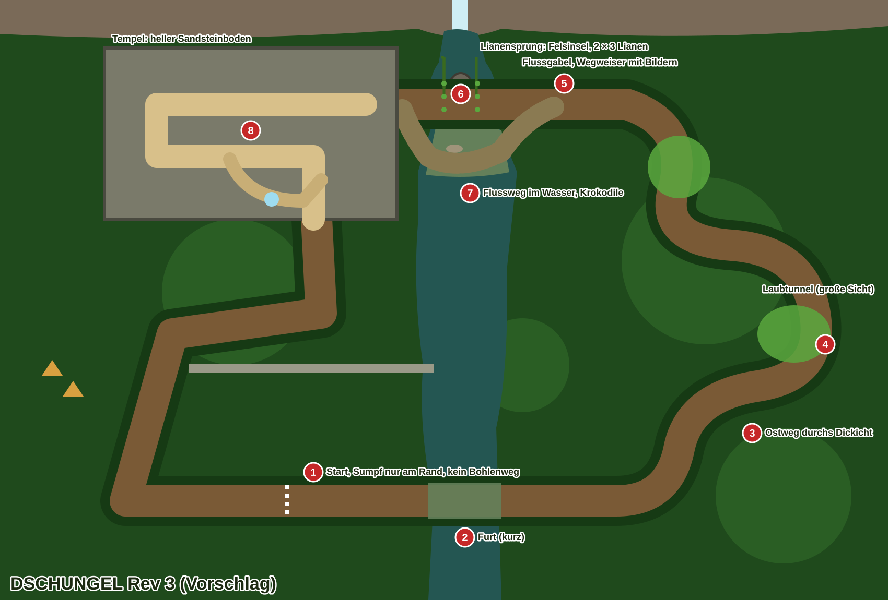

# DSCHUNGEL Rev 3 – Umsetzungsplan

Stand: 2026-11-21, Branch `map_pack`. Vorschlag von Claude nach der ersten Testfahrt von Rev 2 (8 Testmeldungen vom 2026-11-21, ROADMAP 1S11-13 bis 1S11-20). Noch nicht begonnen; vor der Umsetzung die offenen Fragen klären (ROADMAP 1S11-19). Grundlage: Rev 2 (`plaene/DSCHUNGEL_REV2.md`, Abschnitt „Umsetzung“), Skills `strecke` und `mechanik` (Abschnitt 17), Streckendesign-Grundsätze in `CLAUDE.md`.

Grobes Mockup von Claude (ersetzt kein Mockup des Nutzers): [mockups/DSCHUNGEL_REV3.svg](mockups/DSCHUNGEL_REV3.svg)



## Ziel in einem Satz

Der Fluss wird zum Herz der Strecke: oben über der Schlucht entscheidet man sich zwischen dem Lianensprung von Stein zu Stein (schnell, mit mehreren Lianen, eine freie bringt dich sicher hinüber) und dem Flussweg unten durchs Wasser zwischen den Krokodilen; dazwischen fährt man durch dichten, engen Dschungel statt über eine Wiese mit Einzelbäumen.

## Was die Testfahrt gesagt hat (2026-11-21)

| ID | Befund | Antwort in Rev 3 |
|---|---|---|
| 1S11-13 | Wegweiser unverständlich, ein Pfeil falsch | neue Schilder mit Bildern des Wegs (Welle und Krokodil, Liane), Pfeile in echter Richtung; Abschnitt „Wegweiser“ |
| 1S11-14 | Bohlenweg-Abzweigung sinnlos, zu nah am Start | Bohlenweg entfällt; der Sumpf liegt nur noch an den Rändern der Startgeraden |
| 1S11-15 | Laubdach: sieht nichts, nur Entengrütze, kein Mehrwert | Unterholz-Feld und Sumpfrinne entfallen; Laubdach nur noch als kurze Laubtunnel mit großer Sicht (offene Frage 1) |
| 1S11-16 | unsaubere Steine an der oberen Einmündung | die Einmündung des Trampelpfads entfällt; alle Übergänge mit der neuen Dickicht-Wand (glatt) |
| 1S11-17 | nicht dschungelig: grüne Masse statt Einzelbäume, enger | **Dickicht als Begrenzung** auf der ganzen Strecke, 18–40 px neben der Straße, fest |
| 1S11-18 | Liane fast nie auf der richtigen Seite | **breiter Lianenübergang** mit drei Lianen je Lücke; eine freie, ruhende Liane bringt dich sicher hinüber |
| 1S11-19 | Fluss prominenter, Teil der Strecke (unten durchs Wasser mit Krokodilen oder oben mit Lianen von Stein zu Stein) | genau diese **Gabelung** oben am Fluss |
| 1S11-20 | Tempel zu dunkel, grau auf grau | warmer, heller Sandstein-Boden mit dunklen Fugen und Rand, dunkle moosige Wände, Dunkel etwas schwächer |
| gefallen | Fall-Animation in den Fluss, die Liane | bleibt (die Animation wird für jeden Sturz in den Fluss genutzt) |

## Entscheidungen (Vorschlag, vom Nutzer zu bestätigen)

| Frage | Vorschlag |
|---|---|
| Umfang | Umbau der Osthälfte und des Flussübergangs; Startgerade, Furt, Tempel, Treppe, Westhaken, Lager bleiben (mit Kontrast-Korrektur im Tempel). `rev: 3` |
| Kartengröße | bleibt 1700 × 1150 |
| Rundenzeit | Ziel 36–40 s mit dem Bot (heute 30–34 s, 1S11-11): der Ostweg windet sich länger durchs Dickicht, der Flussweg ist ein echter Umweg |
| Gabelungen | (1) **am Fluss oben**: Lianensprung (Mittellinie) oder Flussweg (Nebenweg); (2) im Tempel: Kugelgang oder Wasserfallgrotte (wie Rev 2) |
| Waschen | nur die Wasserfallgrotte (wie Rev 2); Flussweg und Furt waschen nicht (offene Frage 4) |
| Ereignisse | `baeume` (am Ostweg und an der Treppe), `kroko` (jetzt vor allem im Flussweg, dazu ein, zwei in der Furt), `steinkugel` (wie Rev 2) |

### Offene Fragen an den Nutzer

1. **Laubdach**: ganz streichen oder als zwei kurze **Laubtunnel** am Ostweg (je 120–160 px, Loch um dein Auto mit Radius 120 statt 54–74, kein Matsch darunter)? Vorschlag: Laubtunnel, damit die Idee „man sieht nicht alles“ bleibt, ohne zu nerven.
2. **Fehlgriff an der Liane**: Vorschlag wie heute: Sturz in den Fluss mit der Treib-Animation, zurück hinter der Schlucht (dort, wo beide Wege wieder zusammenkommen). Alternative: der Fluss spült dich in den Flussweg, du fährst ihn weiter.
3. **Wie viele Steine**: eine Felsinsel mitten in der Schlucht (zwei Sprünge, Vorschlag) oder zwei Inseln (drei Sprünge, länger, mehr Risiko)?
4. **Flussweg**: wäscht nicht (Vorschlag, ein Wasch-Konzept: die Grotte) oder wäscht ein wenig?
5. **Furt unten**: behalten als kurze Furt ohne Krokodile (Vorschlag) oder dort eine Hängebrücke, damit der Fluss nur einmal durchfahren wird?

## Grundriss (Rev 2 → Rev 3)

```
 x:  0         400        800       1200       1700
 y ┌──────────────────────────────────────────────┐
  0 │ ▓▓▓▓▓▓ TAFELBERG ▓▓▓▓ (W)asserfall ▓▓▓▓▓▓▓▓▓▓▓ │
    │ ┌── TEMPEL ──┐   ◄═ Liane ═ ◆ ═ Liane ═╗       │
200 │ │ U-Gang     │◄══╗  (3 Lianen je Lücke) ║ Dickicht│
    │ │ Halle Gabel│   ╚═ Flussweg im Wasser ═╝      │
400 │ └──┬─Treppe──┘      (Krokodile, Strömung)  ║    │
    │    ▼              ≈≈ Fluss tief ≈≈   Ostweg ║    │
600 │  Westhaken        ≈≈≈≈≈≈≈≈≈≈≈≈≈    (Kurven, ║    │
    │  Ruinenmauer      ≈≈≈≈≈≈≈≈≈≈≈≈≈   Laubtunnel)║   │
800 │  Lager              ≈≈≈≈≈≈≈                 ║    │
    │ 🏁 Start ════ Sumpfränder ════ FURT ════════╝    │
1150└──────────────────────────────────────────────┘
```

Fahrtrichtung wie Rev 2 (Start unten links nach Osten, gegen den Uhrzeigersinn).

| Stelle | Rev 3 |
|---|---|
| Startgerade, Sumpf | wie Rev 2, aber **ohne Bohlenweg**; Sumpf-Senken nur an den Rändern (die Linie bleibt sauber, wer weit außen fährt, wird grün) |
| Furt | wie Rev 2, kurz; ohne Krokodile oder mit einem (offene Frage 5) |
| Ostweg | statt Gabel, Unterholz-S und Trampelpfad **eine** gewundene Straße nach Norden durch dichtes Dickicht (x 1100–1600), mit zwei Laubtunneln (offene Frage 1) und morschen Bäumen; Mittellinie etwa 1500 px |
| Flussgabel | oben östlich der Schlucht (≈ 1050, 200): geradeaus der **Lianensprung**, rechts hinunter der **Flussweg** |
| Lianensprung | Schlucht unter dem Wasserfall auf 110 px verbreitert (drei Spuren), in der Mitte eine **Felsinsel** (fest, Straße darauf); zwei Lücken, über jeder Lücke drei Lianen nebeneinander |
| Flussweg | eine Rampe hinunter ins Flussbett unterhalb des Tümpels, 220–260 px quer und schräg durch flaches Wasser (Code 91), Strömung flussab, an der Unterseite tiefe Kolke (Code 5), Kiesbänke als Inseln, Krokodile; Rampe hinauf am Westufer, dort zurück auf die Mittellinie vor dem Tempeltor |
| Tempel | wie Rev 2, Kontrast neu (siehe unten) |
| Treppe, Westhaken, Lager | wie Rev 2 |

## Die Elemente

### Dickicht als Begrenzung (1S11-17, Paket R2)

- Eine zusammenhängende **grüne Masse** aus Baumkronen, Farnen, Lianen und Büschen, wo heute Wiese mit Einzelbäumen ist. Begrenzung aus einem Guss wie das Gebirge im Eis: glatte Abstandsfunktion zur Straße, Rand verrauscht 18–40 px neben der Fahrbahn (enger als heute), in Kurven an der Innenseite etwas weiter (Sicht), an Gabelungen und Einmündungen weich.
- Im Bild: Boden dunkel (Schatten), darüber im `top`-Bild dichte Kronen mit hellen Lichtflecken und Blüten; der Rand zur Straße hat einen kräftigen Schatten (Grundsatz 10: fest ist kräftig).
- Fest: Kreise mit `edgeCircles` am Umriss (wie Würgefeigen in Rev 2). Kein Gras-Streifen mehr, in den man rutscht: wer anstößt, prallt ab.
- Lichtungen nur, wo etwas ist: Lager, Becken, Steinköpfe, Ruinenmauer.
- Theme-Bäume (`th.trees`) fast null; die Masse ersetzt sie. Bauzeit messen (ein zusätzliches Abstandsfeld über die ganze Karte; Ziel: Bau nicht über 1,6 s).

### Lianensprung (1S11-18, Paket R3)

- **Drei Lianen je Lücke**, nebeneinander quer zur Fahrtrichtung, je eine Spur (Spurbreite 34 px). Zustände je Liane:
  - **ruht**: hängt senkrecht in der Mitte der Lücke, sichtbar mit Schatten auf der Kante;
  - **trägt**: wer an der Kante in ihrer Spur ankommt, während sie ruht, wird gegriffen und sicher hinübergeschwungen (Tarzan-Schrei), immer erfolgreich;
  - **kehrt zurück**: schwingt 2,5 s leer zurück und pendelt aus; in dieser Zeit greift sie niemanden.
- Kommt man in einer Spur mit besetzter Liane an, fällt man in den Fluss (Treib-Animation wie Rev 2, die dem Nutzer gefällt). Man sieht also schon von weitem, welche Spur frei ist (ruhende Liane, ihr Schatten), und lenkt hinein: Können statt Glück.
- Die **Felsinsel** in der Mitte (fest, Moos, Straße darauf) ist die Landung der ersten und der Absprung der zweiten Lücke.
- Kein Baumstamm mehr (der sichere Weg ist jetzt der Flussweg).
- KI: wählt an der Kante die nächste freie Spur (Zeit voraus rechnen, wie Rev 2), auf LEICHT seltener den Lianensprung (Flussweg).

### Flussweg (1S11-19, Paket R4)

- Rampe ins Flussbett, dann **im Wasser** schräg flussab und hinüber: flaches Wasser (Code 91, .72), Strömung schiebt flussab (zum Tümpel-Abfluss hin wird es tief: Kolke Code 5 an der Unterseite), zwei Kiesbänke als trockene Inseln, Steine und Treibholz fest.
- **Krokodile** (Ereignis `kroko`): vier bis fünf liegen im Flussweg wie Stämme, Ankündigung wie Rev 2 (Augen, Blasen, langsam aufgehendes Maul), Schnapp = Dreher; ab Runde 2 schwimmt eins quer. Nie zwei schnappen gleichzeitig nebeneinander (man muss durchkommen).
- Länger als der Lianensprung (etwa 1,5 bis 2,5 s Umweg), dafür ohne Sturz.
- Rampe hinauf am Westufer; gemeinsamer Weg ab etwa 40 px vor dem Tempeltor.

### Laubtunnel (1S11-15, Paket R5, nach Antwort auf Frage 1)

- Zwei kurze Stücke am Ostweg, je 120–160 px, Kronen geschlossen über der Straße, Loch um dein Auto mit Radius 120 (weicher Rand), Glühwürmchen, kein Matsch darunter, kein Ereignis darunter (Grundsatz 9).

### Wegweiser (1S11-13, Paket R5)

- An der Flussgabel zwei große Holzschilder, je mit **Bild des Wegs** und Pfeil in die echte Richtung: Liane über einer Lücke (geradeaus), Welle mit Krokodilkopf (rechts hinunter). Pfeile nicht spiegeln (Rev 2: der zweite Pfeil zeigte nach links).
- Im Tempel vor der Halle: Steintafel mit Wassertropfen (Grotte, waschen) und Kugel (Kugelgang).

### Tempel-Kontrast (1S11-20, Paket R5)

- Boden: warmer heller Sandstein (etwa `#d8c08a`/`#c8ae76`) mit dunklen Fugen und einer **dunklen Randleiste** zur Wand; Wände dunkel grünlich-grau mit Moos (heute beides grau).
- Dunkel `.9` → `.78`, Fackeln am Rand der Fahrbahn etwas dichter (alle 80 px statt 110), Autolampen bleiben.
- Prüfen mit Bild im Rennen in der Halle und im U-Gang.

## KI

- Flussgabel: Hook `target` wie Rev 2 (`c.jgWay`); Lianensprung für SCHWER und mutige Autos, Flussweg für LEICHT und die Hälfte auf MITTEL; vor der Kante die freie Spur (Hook `lane`).
- Flussweg: gegen die Strömung halten (oben bleiben), Krokodile in `T.ev.obst` ab Warnung.
- Dickicht: Hook `wander` kleiner (die Straße ist eng), kein Ausweichen in die Masse.

## Arbeitspakete

| Paket | Inhalt | Prüfen | Status |
|---|---|---|---|
| R1 Grundriss | Unterholz, Sumpfrinne, Trampelpfad, Bohlenweg raus; Ostweg als Mittellinie; Flussgabel (Mittellinie = Lianensprung, Flussweg als Nebenweg, noch schlicht); `rev: 3` | `check`: Start, Abkürzungen, 10/10 im Ziel, Rundenzeit | offen |
| R2 Dickicht | grüne Masse als Begrenzung über die ganze Strecke, fest, Schatten; Theme-Bäume raus | `check`, `checkPic`, Bauzeit, Bild im Rennen | offen |
| R3 Lianensprung | breite Schlucht, Felsinsel, 2 × 3 Lianen mit Zuständen, Sturz mit Treib-Animation, KI-Spurwahl | `check` alle Stufen (Stürze an der Schlucht), Bild | offen |
| R4 Flussweg | Flussbett, Rampen, Strömung, Kolke, Kiesbänke, Krokodile, KI | `check` LEICHT/SCHWER, Stürze im Flussweg | offen |
| R5 Feinschliff | Laubtunnel (Frage 1), Wegweiser, Tempel-Kontrast, Übergänge sauber (1S11-16) | Bilder im Rennen | offen |
| R6 Abschluss | `check` LEICHT/MITTEL/SCHWER mit 3, 5, 10 Autos, Grundsätze 1–14, Bauzeit, Frame-Zeit; Doku: `ROADMAP.md` (1S11, Tabelle), `Strecken.md`, Skill `mechanik` Abschnitt 17 | alles | offen |

## Grundsätze-Check (für R6)

1. Steigerung: schwerer als VULKAN durch enge Fahrbahn, Lianen-Timing, Krokodile, Dunkel im Tempel.
2. Der Fluss kommt vom Wasserfall und fließt zum Südrand; die Felsinsel liegt im Fluss; die Rampen führen ins Flussbett und hinaus.
3. Sumpf nur an den Rändern der Startgeraden; Kolke dort, wo die Strömung hinzieht.
4. Dickicht und tiefer Fluss sperren jede Abkürzung; die Wegweiser sagen, wohin.
5. Startaufstellung unverändert gerade.
6. Mehr als ein Kreis: Lianensprung oder Flussweg, Kugelgang oder Grotte.
7. Ereignisse `baeume`, `kroko`, `steinkugel`, alle ausschaltbar.
8. Lied `jungle` in Schichten (wie Rev 2).
9. Krokodile nur im Wasser, Bäume nur am Ostweg und an der Treppe, Kugel nur im Kugelgang; unter den Laubtunneln nichts.
10. Dickicht kräftig mit Schatten, ruhende Liane klar zu sehen, Tempelboden hell gegen dunkle Wand.
11. Nicht kindgerecht: geschnappt, in die Schlucht gestürzt, platt gewalzt.
12. Matsch: Ränder der Startgeraden; Wahl eher Lianen-Risiko gegen Flussweg-Umweg.
13. Waschen: nur die Grotte.
14. Nichts über Ziellinie und Startaufstellung.
