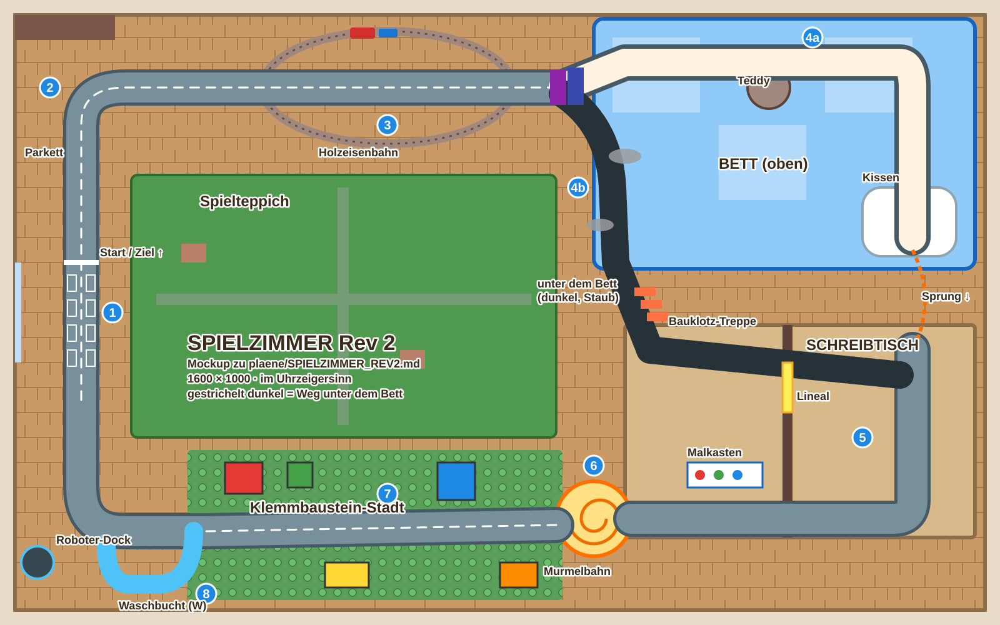

# SPIELZIMMER Rev 2 – Umsetzungsplan

Stand: 2026-10-31, Branch `map_pack`. Eigener Plan für den Umbau des Spielzimmers (Strecke 14, Cup 5) in das neue Format. Er steht bewusst nicht in `ROADMAP.md`; dort bleibt nur der Block `1S14` mit einem Verweis hierher. Grundlage: Prototyp in `src/toys.js` und `src/toymap.js`, `Strecken.md` Abschnitt 14 (mit „Fehlt noch“), ROADMAP 1S14-1 bis 1S14-5, Skills `strecke` und `mechanik`, Streckendesign-Grundsätze in `CLAUDE.md`. Gemeinsamer Rahmen: `plaene/REWORKS_CUP4_CUP5.md`. Vorbild: `plaene/EIS_REV2.md`, `plaene/WUESTE_REV3.md`, `plaene/VULKAN_REV2.md` (Branch `vulkan_rev2`).

**Status je Paket** wird hier gepflegt. Erst beim Abschluss (K8) wird `ROADMAP.md` nachgezogen: 1S14, Tabelle, 1A-4, 1M-2, 1P-1, 1P-2, 3E-6.

Grobes Mockup von Claude (2026-10-31, ersetzt kein Mockup des Nutzers): [mockups/SPIELZIMMER_REV2.svg](mockups/SPIELZIMMER_REV2.svg)



## Ziel in einem Satz

Das Spielzimmer wird größer und bekommt eine echte Wahl in der Höhe: vom Spielteppich über Parkett und Holzeisenbahn an die Bücherrampe, dann **über das Bett** (Kissen-Sprung auf den Schreibtisch, schnell, wer fällt, landet unten) **oder unter dem Bett** durch Staub und Dunkelheit hinauf zum Schreibtisch, über Lineal und Malkasten, die Murmelbahn hinunter in eine Klemmbaustein-Stadt; ab Runde 2 jagt der Saugroboter auf dem Boden, in der letzten Runde geht das Licht aus.

## Ausgangslage (Prototyp)

Das Spielzimmer ist der reichste Prototyp; der Umbau ist darum **kein Abriss**, sondern bringt es ins neue Format (größere Karte, Gabelungen, Seitenbucht, Schichten im Lied, Ankündigung ohne Text).
- 1280×720, Runde 26–28 s, Rennen etwa 85 s.
- Vorhanden und brauchbar: Ebenen Boden, Bett, Schreibtisch (`c.lvl`, die Ebene folgt `c.idx`), Spielteppich mit aufgedruckter Straße, Parkett (Code 30, rutschig), Bettdecke (31), Wasserfarbe (32), Holzeisenbahn mit Schranken, Bücherrampe, Teddy, Kissen-Sprung auf den Schreibtisch, Lineal-Brücke, Buntstifte, Radiergummi, Malkasten mit sauberem Zweig, Murmelbahn-Spirale, Bauklotz-Viertel mit Burg und Mauer gegen die Abkürzung, Knete (bunt gesprenkelt), Spielzeug-Waschstraße, Ereignisse `spielzeug` (Zug, Aufziehauto, Murmeln, Domino) und `saugroboter` (ab Runde 2, Licht aus in der letzten Runde), Lied `toys`.
- Schwach: Startgerade nur 115 px bis zur Kurve (1S14-1, 1A-4: 90°); die KI fällt nie vom Kissen (1S14-2); der Saugroboter erwischt kaum ein Computerauto (1S14-3); Knete-Spritzer färben die Straße dauerhaft (1S14-4, 3E-6); Lied ungehört (1S14-5); nach dem Sturz vom Kissen zurück an den Anfang der Kissen-Geraden statt „unter dem Bett, lange Rampe zurück“ (Strecken.md „Fehlt noch“); der Roboter saugt keine Knete; die Waschstraße liegt auf der Linie (jeder wird gewaschen, Grundsatz 13); Text „SAUGROBOTER!“, „SCHLAFENSZEIT!“, „SCHLUERF!“.

## Entscheidungen (Vorschlag, vom Nutzer zu bestätigen)

| Frage | Vorschlag |
|---|---|
| Umfang | **Umbau im neuen Format**: Möbel, Mechaniken und Ereignisse bleiben, die Karte wird größer, die Strecke neu angeordnet, die Höhe wird zur Wahl |
| Kartengröße | **1600 × 1000** (1,6 Mpx); das Zimmer ist ein Zimmer: Wände am Kartenrand (Fußleiste, Steckdosen, Tür) als natürliche Grenze |
| Rundenzeit | Ziel **50–55 s** |
| Gabelung am Bett | **Über das Bett** (Bücherrampe, Bettdecke, Teddy, Kissen-Sprung auf den Schreibtisch: schnell, Risiko) oder **unter dem Bett** (dunkel über die Lichtkarte, Staubflusen, Socken, verlorene Spielsachen, am Ende eine lange Bauklotz-Treppe hinauf auf den Schreibtisch: langsamer, sicher). **Wer vom Bett oder Kissen fällt, landet unter dem Bett und fährt dort weiter** (kein Zurücksetzen an den Anfang mehr) |
| Ebenen | Die Ebene folgt nicht mehr nur `c.idx`, sondern dem Zweig (Bett-Zweig Ebene 1, Unter-Bett-Zweig Ebene 2 Boden mit Decke darüber). Zusammenstöße weiter nur auf derselben Ebene |
| Schreibtisch | Bleibt (Lineal zwischen zwei Tischen, Buntstifte, Radiergummi, Malkasten mit sauberem Zweig); die Tischkante bleibt ein Fall, Rückkehr auf den Tisch hinter die Fallstelle (`c.safe`) |
| Waschen | **Spielzeug-Waschstraße als Seitenbucht** vor dem Ziel (Bürsten, Rubbeln, vorhanden), nicht mehr auf der Linie |
| Ereignisse | `spielzeug` (Zug, Aufziehauto, Murmeln, Domino) über die Strecke verteilt, je Abschnitt eins; `saugroboter` ab Runde 2 auf dem Boden, sucht gezielt Autos (1S14-3) und saugt Knete weg; **neu `schlafenszeit`** (Licht aus in der letzten Runde) als eigener Schalter, damit Saugroboter und Dunkelheit getrennt ausschaltbar sind |
| Nicht kindgerecht (Grundsatz 11) | Tiefe Stürze, ein Roboter, der jagt, Dunkelheit unter dem Bett und am Ende; die Optik bleibt verspielt, die Herausforderung echt |
| Name, Rekorde | Name `SPIELZIMMER` bleibt, `rev: 2`. Lied `toys`: Schichten an den Runden (heute: Tempo 112 → 124 BPM mit dem Roboter, das wird eine Schicht ohne Tempowechsel, 1M-1) |

### Offene Fragen an den Nutzer

1. Mockup vorhanden?
2. Gabelung über oder unter dem Bett gut? Oder zusätzlich das Bücherregal als dritte Höhe (Vorschlag: nein, Grundsatz 9)?
3. Soll ein Sturz vom Schreibtisch auch in einen Weg unten führen (wie beim Bett), oder reicht Zurücksetzen auf den Tisch?
4. `schlafenszeit` als eigener Schalter gut?
5. Klemmbaustein-Stadt als offenes Feld (Noppenplatte, Häuser als Hindernisse, Vorschlag) oder enge Schikane wie heute?

## Grundriss

```
 x:  0        300       600       900       1200      1600
 y ┌───────────────────────────────────────────────────────────┐
  0 │ ▥▥Regal▥  ╭──(3) HOLZEISENBAHN (Oval)──╮ ┌──── BETT ─────────┐│
    │ (2)PARKETT│  Schranken ×2   Bahnhof    ├─┤(4a) Bettdecke,    ││
200 │ ╭─────────╯                            │ │ Teddy, Kissen ⇗   ││
    │ │                   Fenster-Licht      ╰─┤(4b) UNTER DEM BETT ││
400 │ │                                         │  dunkel, Staub    ││
    │ 🏁(1)  SPIELTEPPICH (Straßendruck)        └──┬─ Treppe ↑ ─────┘│
600 │ │        Puppenhaus  Spielzeugkiste   ┌─ SCHREIBTISCH (5) ────┐│
    │ │                                     │ Lineal, Stifte, Malk. ││
800 │ │ (8)Wasch- ◄── (7) KLEMMBAUSTEIN- ◄──(6) Murmelbahn-Spirale  ││
    │ ╰─bucht     STADT, Dominos             └──────────────────────┘│
1000└───────────────────────────────────────────────────────────────┘
```

Fahrtrichtung (Uhrzeigersinn): Start auf dem Spielteppich links nach Norden (1), Parkett-Kurve (2), oben nach Osten über die Holzeisenbahn (3), an der Bücherrampe die Gabelung: über das Bett (4a) oder darunter (4b); beide enden auf dem Schreibtisch (5); die Murmelbahn (6) hinunter auf den Boden, durch die Klemmbaustein-Stadt (7) nach Westen, an der Waschbucht (8) vorbei ins Ziel. Der Saugroboter hat sein Dock an der Westwand.

Richtwerte (in K1 festlegen):

| Stelle | Richtwert (Spielpixel) |
|---|---|
| Karte | 1600 × 1000, Wände 24 px am Rand |
| Startlinie / Aufstellung | Linie (130, 420), Aufstellung y 440–660 (Fahrt nach Norden), mindestens 160 px Gerade hinter der Linie bis zur Parkett-Kurve (1S14-1) |
| Parkett (2) | x 40–420, y 40–260 |
| Holzeisenbahn (3) | Oval um (620, 140), rx 200, ry 90; zwei Übergänge |
| Bett (4a) | x 950–1560, y 30–420; Bücherrampe bei x 900; Kissen am Südende, Sprung nach Süden auf den Schreibtisch |
| Unter dem Bett (4b) | dieselbe Fläche auf Ebene Boden, Weg am Westrand des Betts entlang, Treppe bei (1000, 470) |
| Schreibtisch (5) | x 1000–1560, y 520–860 (zwei Tische, Lineal dazwischen) |
| Murmelbahn (6) | Turm bei (950, 830), r 60 |
| Klemmbaustein-Stadt (7) | x 300–900, y 720–960 |
| Waschbucht (8) | an der unteren Geraden, x 160–300, Südseite, vor der letzten Kurve |

Rundenzeit-Schätzung: Teppich und Parkett 7 s, Eisenbahn 6 s, Bett 10 s (darunter 12 s), Schreibtisch 9 s, Murmelbahn 4 s, Stadt 9 s, Rest 5 s ≈ **50–52 s**.

## Die Elemente

| # | Element | Umsetzung |
|---|---|---|
| 1 | **Spielteppich** | Wie heute (aufgedruckte Straße, Zebrastreifen, blasse Nebenstraßen, Häuser, Bäume, Teich), größer; daneben Teppichflor (bremst wie Gras). Startgerade lang (1S14-1) |
| 2 | **Parkett-Kurve** | Code 30 (halb so glatt wie Glatteis), Straße aus Malerkrepp; Socken liegen auf dem Parkett (Deko, flach) |
| 3 | **Holzeisenbahn** | Oval mit zwei Übergängen, Holzschranken klappen weg (vorhanden), Bahnhof oben. Teil des Ereignisses `spielzeug`; ohne Ereignis steht der Zug am Bahnhof |
| 4a | **Über das Bett** | Bücherrampe (vorhanden), Bettdecke (Code 31, holprig) mit **echten Falten als kleine Hügel** (kurze Sprünge `jumps` mit kleinem `vz`, statt nur Ruckeln), Teddy (fest), Kissen-Sprung auf den Schreibtisch (vorhanden). Bettkante: wer sie verlässt, fällt **auf den Boden unter dem Bett** (Pfeifen, Landung auf Zweig 4b, Ebene Boden, kein Zurücksetzen) |
| 4b | **Unter dem Bett** | Dunkel über die Lichtkarte (Wüste), Lampen an den Autos, Licht fällt nur an den Bettkanten herein. Boden mit **Staubflusen** (neu Code 120: bremst wie Matsch, macht staubgrau) in Senken, dazwischen saubere Spuren (Grundsatz 12). Verlorene Spielsachen als Hindernisse (Murmel, Würfel, Buntstiftstummel), Socken, ein Monster-Kuscheltier mit leuchtenden Augen (Gag, Optik). Am Ende eine **Bauklotz-Treppe** (Rampe) hinauf auf den Schreibtisch (Ebene wechselt auf 3). Der Saugroboter kommt **nicht** unter das Bett (zu niedrig) |
| 5 | **Schreibtisch** | Wie heute: liniertes Papier mit Bleistiftrand, Buntstifte als Begrenzung, Radiergummi, Hefte, Klebezettel, Stiftebecher, Lampe; Lineal-Brücke zwischen den Tischen; Malkasten mit sauberem Zweig (Wasserfarbe Code 32). Tischkante: Fall, Rückkehr auf den Tisch hinter der Fallstelle |
| 6 | **Murmelbahn** | Spirale nach unten wie heute (`c.lvl` 4), unten Schub; aus ihr rollen Murmeln (Ereignis) |
| 7 | **Klemmbaustein-Stadt** | Offenes Feld auf einer großen Noppenplatte (neu Code 121: holprig, volle Haftung, leichtes Ruckeln), Häuser, Türme und Mauern aus Bauklötzen und Klemmbausteinen als feste Formen mit Schatten; Gassen mit aufgemalten Pfeilen (lesbar, Grundsatz 4). Die Burg und die Mauer gegen die Abkürzung durch die Mitte bleiben. Knete-Fladen (Code 2 mit Knete-Sprites) in Gassen, vom Rand her. Dominoturm am Rand einer Gasse |
| 8 | **Waschbucht** | Spielzeug-Waschstraße als Seitenbucht (Plastikboden, gelbe Pfosten, drehende Bürsten, vorhanden) |
| 9 | **Kulisse** | Bücherregal an der Wand, Fenster mit Gardine, die sich bewegt, Lichtstrahlen mit Staub nur im Licht, Puppenhaus, Spielzeugkiste, Puzzleteile, Quietscheente, Ball, Kinderzeichnungen an der Wand, Tür mit Lichtspalt (in der letzten Runde), Nachttisch mit Sternenprojektor und Nachtlicht |

Bleibt: Ebenen, Teppich, Parkett, Bettdecke, Wasserfarbe, Holzeisenbahn, Bücherrampe, Teddy, Kissen-Sprung, Lineal, Buntstifte, Malkasten, Murmelbahn, Bauklötze, Knete, Waschstraße, alle Ereignis-Teile, Sternenprojektor, Lied.
Entfällt: Zurücksetzen an den Anfang der Kissen-Geraden (`runup`), die Ebene allein aus `c.idx` (für das Bett), die Waschstraße auf der Linie (`washAt`), die Texte „SAUGROBOTER!“, „SCHLAFENSZEIT!“, „SCHLUERF!“ (Ton und Symbol statt Text).

## Waschen (Grundsatz 13)

Nur die **Waschbucht**. Wasserfarbe färbt, Knete und Staubflusen machen schmutzig, nichts davon wäscht. Die Bucht wäscht nicht sofort (Bürsten, Rubbeln), KI nur dreckig (Schwellen .4 / .55 / .7, Gas ≤ .6).

## Ereignisse

| Schlüssel | Ablauf | Ankündigung | Ort |
|---|---|---|---|
| `spielzeug` | Je Abschnitt ein Spielzeug, nicht zwei zugleich: **Zug** auf dem Oval (Runde 1 einmal je Runde, dann öfter), **Aufziehauto** auf dem Teppich, **Murmeln** aus der Murmelbahn quer über die Ausfahrt (Runde 2 mehr), **Domino** in der Stadt (fällt bei Berührung, steht nach 20 s wieder) | Pfeife und Schranken (Zug), Ratschen (Aufziehauto), Klackern in der Bahn 1 s vorher (Murmeln), Wackeln des Turms (Domino) | Eisenbahn, Teppich, Murmelbahn, Stadt |
| `saugroboter` | Ab Runde 2 fährt er aus dem Dock: nicht mehr nur gerade Bahnen, sondern **sucht** das nächste Auto auf dem Boden, wenn er lange niemanden erwischt hat (1S14-3); zieht an, saugt ein, spuckt hinter sich staubgrau aus (1,2 s). Saugt Knete-Fladen und Spritzer weg (die Strecke wird sauberer), Murmeln und liegende Dominos. Nicht auf Bett, Schreibtisch und unter dem Bett | Piepen und blaues Blinken beim Losfahren, Summen wird lauter, je näher er ist; Warndreieck am Bildrand in seiner Richtung, wenn er auf ein Auto zuhält | Boden: Teppich, Parkett, Stadt |
| `schlafenszeit` (neu) | Letzte Runde: Lichtschalter-Klick, das Zimmer wird dunkel (Lichtkarte, Lampen an allen Autos), Sternenprojektor wirft drehende Sterne und einen Mond, Nachtlicht glüht, Lichtspalt unter der Tür; der Roboter fährt mit blauen Lichtern weiter. Ziellinie und Aufstellung bleiben im Licht des Nachtlichts sichtbar (Grundsatz 14) | Lampe flackert 1 s, Klick | ganzes Zimmer |

`T.ev`-Felder beginnen mit `toy` (heute schon `toyRobot` u. a., prüfen).

## Lied `toys`

Schichten an den Runden (1M-1), kein Tempowechsel:
- Runde 1: Toy-Piano, Xylophon, Holzklötze, Klicks, Tuba-Bass.
- Runde 2 (Roboter): Brumm-Drone und dichtere Holzklicks (statt 124 BPM).
- Letzte Runde (Licht aus): Spieluhr-Schlaflied als Melodie, Drums als leise Klicks.
- Unter dem Bett: gedämpft (Filter zu), wie im Tempel und in der Pyramide.
- Lied muss angehört werden (1S14-5, 1M-2).

Neue Töne: Staubflusen (weiches Wischen), Bauklotz-Treppe (Klack je Stufe), Monster-Kuscheltier (Brummen), Gardine.

## Performance (Pflicht, ROADMAP 1P-1)

Bau:
- Möbel als einzelne Bau-Schritte über ihre Rechtecke, Teppichdruck und Parkett als Muster (Kacheln), nicht je Pixel gewürfelt.
- Unter dem Bett: Lichtkarte nur in der Größe des Betts vorrechnen.

Laufzeit:
- Lichtkarte nur, wenn der Spieler unter dem Bett ist oder in der letzten Runde.
- Knete-Spritzer: auf eine eigene Ebene mit Verblassen (1S14-4, 3E-6), nicht dauerhaft in `tctx`.
- Roboter-Sog: ein Abstandsquadrat je Auto.
- Sterne des Projektors als Sprite, gedreht gezeichnet.
- Messen in K8: Bauzeit (heute groß, 1P-1), Frame-Zeit unter dem Bett und in der letzten Runde mit 10 Autos, Mobilgröße.

## Technik

- **`TRACK_DEFS`**: `rev: 2`, `W: 1600`, `H: 1000`, neue `poly`; Felder `room` (Wände, Tür, Fenster), `bedFork` (Zweig über/unter, Fallzone → Zweig unten), `underBed` (Weg, Staub, Spielsachen, Treppe), `city` (Feld, Häuser, Mauer, Burg), `washBay`; alte Felder angepasst (`bed`, `pillow`, `desk`, `ramp`, `lip`, `land`, `ruler`, `tower`, `fork`, `paints`, `train`, `wind`, `marble`, `domino`, `robot`). Entfallen: `runup`, `washAt`, `blockWall` alt.
- **Ebenen**: `c.lvl` aus dem Zweig, nicht nur aus `c.idx`; ein Sturz vom Bett setzt `c.lvl = 2` und den Zweig auf „unten“ (Hook `stuck` oder `ground`); Skill `mechanik` nachziehen.
- **Boden-Codes**: 120 Staubflusen, 121 Noppenplatte; 30–32 bleiben. Hook `surf`, Liste über `surfOf`, Skills.
- **Dateien**: `src/toymap.js` (neu angeordnet), `src/toys.js` (Gabelung, Ebenen aus dem Zweig, Lichtkarte unter dem Bett, Roboter sucht, `schlafenszeit`), `src/tracks.js`, `src/state.js`, `src/raceopts.js`, `src/music.js`, `src/audio.js`.
- **Fortschritt**: Hook `progress` (Bett und darunter liegen übereinander: der Zweig entscheidet, Stadt-Feld).
- **KI**:
  - Bett-Gabel: SCHWER über das Bett mit Vollgas, LEICHT darunter, MITTEL gemischt; auf LEICHT fällt ab und zu eins vom Kissen (1S14-2), landet unten und fährt weiter.
  - Stadt: breit (Hook `wander`), Häuser über `T.ev.obst`.
  - Roboter: weichen aus, aber nicht perfekt (Reichweite des Ausweichens nach Stufe), damit er auch Computerautos erwischt (1S14-3).
  - Bucht: nur dreckig.
- **Prüfung**: `check('SPIELZIMMER')` kennt Ebenen nicht (Skill `strecke`): Abkürzungen über Möbel von Hand im `checkPic` ansehen.

## Arbeitspakete

| Paket | Inhalt | Prüfen | Status |
|---|---|---|---|
| K1 Grundriss | Kartengröße, Zimmerwände, Mittellinie, lange Startgerade, Möbel an neuen Plätzen, Bett-Gabel als zwei Zweige (noch ohne Dunkelheit), Ebenen aus dem Zweig, Checkpoints, `progress` | `check`: Start gerade (1S14-1), 10/10; Bauzeit | offen |
| K2 Über das Bett | Bettdecke mit Falten-Hügeln, Kissen-Sprung, Sturz landet unter dem Bett | `check`, Stürze vom Kissen bei verschiedenen Tempi | offen |
| K3 Unter dem Bett | Lichtkarte, Staubflusen (Code 120), Spielsachen, Monster-Kuscheltier, Bauklotz-Treppe auf den Tisch | `check` alle Stufen, Screenshot, Frame-Zeit | offen |
| K4 Schreibtisch und Murmelbahn | Möbel neu platziert, Lineal, Malkasten-Zweig, Tischkante, Spirale | `check`, Stürze an der Kante | offen |
| K5 Klemmbaustein-Stadt und Waschbucht | Noppenplatte (121), Häuser als Formen, Pfeile, Knete vom Rand, Domino, Waschbucht | `check`, `checkPic` | offen |
| K6 Ereignisse | `spielzeug` je Abschnitt, Roboter sucht und saugt Knete, `schlafenszeit` als eigener Schalter; Texte durch Ton und Symbol ersetzt; Knete-Spritzer verblassen | `check` mit und ohne `fx`; erwischt der Roboter Computerautos? | offen |
| K7 Lied und Kulisse | Schichten ohne Tempowechsel, Filter unter dem Bett; Gardine, Lichtstrahlen, Tür, Zeichnungen; neue Töne | Lied anhören (Nutzer, 1S14-5) | offen |
| K8 Abschluss | Performance, `check` LEICHT/MITTEL/SCHWER mit 3, 5, 10 Autos, Grundsätze 1–14; Doku: ROADMAP (1S14, Tabelle, 1A-4, 1M-2, 1P-1, 1P-2, 3E-6, „Zuletzt abgeglichen“), `Strecken.md` 14 („Fehlt noch“ als umgesetzt markieren), Skills `mechanik` (Codes 120/121, Ebenen aus dem Zweig, „Spielzimmer Rev 2 in Kürze“) und `strecke` | alles | offen |

## Grundsätze-Check (für K8)

1. Steigerung: schwerer als SUESS Rev 2 (echte Stürze in der Höhe, jagender Roboter, Dunkelheit), nicht schwerer als REGENBOGEN Rev 2.
2. Nichts Unlogisches: Rampe aus Büchern aufs Bett, Treppe aus Bauklötzen auf den Tisch, wer vom Bett fällt, ist darunter.
3. Staubflusen in Ecken und Senken unter dem Bett, Knete in Gassen vom Rand her.
4. Keine Abkürzung: Wände, Mauer und Burg in der Stadt, Möbelkanten; Pfeile in der Stadt.
5. Startaufstellung komplett auf der langen Teppich-Geraden.
6. Mehr als ein Kreis: über oder unter dem Bett, Malkasten-Zweig, Stadt-Feld.
7. Ereignisse `spielzeug`, `saugroboter`, `schlafenszeit`.
8. Eigenes Lied `toys`.
9. Nicht zu viel auf einmal: je Abschnitt ein Spielzeug, Roboter nur auf dem Boden, nicht unter dem Bett.
10. Möbelkanten und Bauklötze kräftig, Puzzleteile und Socken flach und blass.
11. Nicht kindgerecht: tiefe Stürze, Roboter, Dunkelheit.
12. Staubflusen gegen saubere Spur, Knete in Gassen gegen Umweg.
13. Waschen: nur die Waschbucht.
14. Ziellinie und Aufstellung auch bei Licht aus sichtbar (Nachtlicht).
