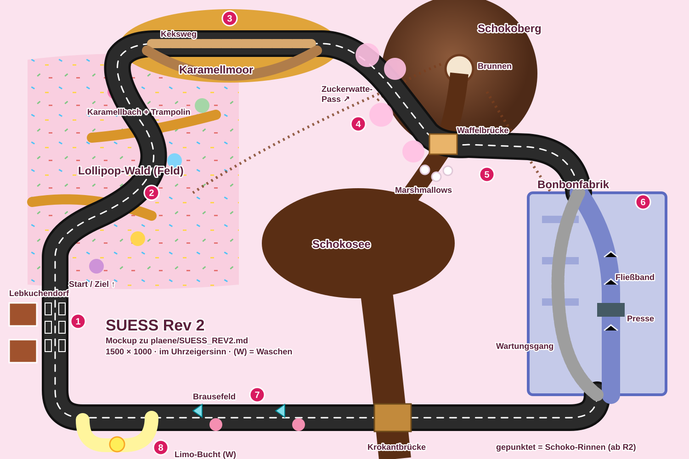

# SUESS Rev 2 – Umsetzungsplan

Stand: 2026-10-31, Branch `map_pack`. Eigener Plan für den Komplettumbau des Süßigkeitenlands (Strecke 13, Cup 5). Er steht bewusst nicht in `ROADMAP.md`; dort bleibt nur der Block `1S13` mit einem Verweis hierher. Grundlage: Prototyp in `src/suess.js`, `src/suessmap.js`, `src/suessmusic.js`, `Strecken.md` Abschnitt 13 und Cup-5-Tabelle, ROADMAP 1S13-1 bis 1S13-3, Skills `strecke` und `mechanik`, Streckendesign-Grundsätze in `CLAUDE.md`. Gemeinsamer Rahmen: `plaene/REWORKS_CUP4_CUP5.md`. Vorbild: `plaene/EIS_REV2.md`, `plaene/WUESTE_REV3.md`, `plaene/VULKAN_REV2.md` (Branch `vulkan_rev2`).

**Status je Paket** wird hier gepflegt. Erst beim Abschluss (S8) wird `ROADMAP.md` nachgezogen: 1S13, Tabelle, 1A-2, 1P-1, 1P-2, 3B-4.

Grobes Mockup von Claude (2026-10-31, ersetzt kein Mockup des Nutzers): [mockups/SUESS_REV2.svg](mockups/SUESS_REV2.svg)



## Ziel in einem Satz

Das Süßigkeitenland wird zur Landschaft um den Schokoberg: vom Lebkuchendorf durch den Lollipop-Wald mit Gummibärchen-Trampolinen, über das klebrige Karamellmoor, den Zuckerwatte-Pass hinauf und über den Schokofluss unter der Quelle, mitten durch eine Bonbonfabrik mit Fließbändern und Bonbonpresse, über das Brausefeld zurück, und ab Runde 2 läuft der Schokobrunnen auf dem Gipfel über.

## Ausgangslage (Prototyp)

- 1200×675, Runde etwa 21 s, Start auf der linken Geraden (7°), Bau 0,8 s.
- Vorhanden und brauchbar: Lakritzstraße, Karamell mit Nachkleben und Fäden, tiefe und flache Schokolade, Gummibärchen-Trampolin (Höhe unabhängig vom Tempo), Kaugummiblasen, Brause-Pads, Zuckerwatte-Bande (federnd wie die Bobbahn), Waffelbrücke, Marshmallow-Trittsteine mit Lakritz-Abkürzung, Limonaden-Brunnen, Lebkuchenhaus, Lollis, Donut-Stapel, Bonbon-Regenbogen, Ereignisse `schoko` (drei Ströme ab Runde 2, Streuselregen in der letzten Runde) und `zuckerwatte` (Wolken verdecken die Sicht), Lied `candy` (eigene Datei `suessmusic.js`).
- Schwach: Karamell, Kaugummi und Wolken bremsen über eine geschätzte Dämpfung statt über `surfOf` (1S13-2); die Ströme haben keine Front und keine Ankündigung außer Text „SCHOKOLADE!“; die Trittstein-Abkürzung nimmt die KI nie (1S13-1, 3B-4); Lebkuchenmänner, Marshmallows, Wattefetzen nur angedeutet; Runde zu kurz (1S13-3, 1P-2); das Limonaden-Becken reicht in die Straße und wäscht jeden (Grundsatz 13); ein Rundkurs mit Abschnitten nebeneinander, die Landschaft ergibt keinen Sinn (der See liegt im Innenfeld, der Fluss läuft zum Rand, aber woher kommt die Schokolade?).

## Entscheidungen (Vorschlag, vom Nutzer zu bestätigen)

| Frage | Vorschlag |
|---|---|
| Umfang | **Kompletter Umbau**: der Schokoberg mit dem Brunnen auf dem Gipfel ist die Quelle von allem (Grundsatz 2), die Strecke läuft um ihn herum und an seiner Flanke hinauf. Bausteine des Prototyps werden wiederverwendet |
| Kartengröße | **1500 × 1000** (1,5 Mpx) |
| Rundenzeit | Ziel **45–50 s** |
| Neu: Bonbonfabrik | Eine Halle wie die Pyramide der Wüste, aber hell: **Fließbänder** (Schub in oder gegen die Fahrtrichtung, `pushes`), eine **Bonbonpresse** (stampft im Takt, fest, mit Schatten und Zischen davor), Gabelung: Fließband mit Presse (schnell) gegen Wartungsgang (langsamer, sicher). Die Presse ist ein Streckenelement, kein Ereignis (wie die Bobbahn-Bande); sie stampft immer im selben Takt, damit man ihn lernen kann |
| Klebrig über `surfOf` | Karamell, Kaugummi, Zuckerguss bekommen eigene Codes (110–114), die Dämpfung entfällt (1S13-2) |
| Waschen | **Limonaden-Bucht** vor dem Ziel: Sprudelbrunnen in einer Seitenbucht, wäscht nicht sofort, danach glitzert das Auto (vorhanden). Das Becken liegt nicht mehr auf der Linie |
| Ereignisse | `schoko` (ab Runde 2 läuft der Brunnen über: Ströme fließen sichtbar die Rinnen des Berges hinunter, mit Front und Ankündigung; letzte Runde Streuselregen), `zuckerwatte` (Wolken nur über Wald und Pass, nicht in der Fabrik, nicht über der Ziellinie) |
| Nicht kindgerecht (Grundsatz 11) | Die Presse drückt platt (wie die Steinkugel, 1 s), die Schokolade schluckt Autos, das Kleben kostet echt Zeit; die Optik bleibt bunt |
| Name, Rekorde | Name `SUESS` bleibt, `rev: 2`. Lied `candy` bleibt, Schichten an den Runden |

### Offene Fragen an den Nutzer

1. Mockup vorhanden?
2. Bonbonfabrik als neuer Abschnitt gut (Vorschlag), oder lieber eine Torten-Etage (Ebenen wie im Spielzimmer; Vorschlag: nein, die Ebenen gehören dem Spielzimmer)?
3. Soll die Presse wirklich ohne Schalter immer laufen (Vorschlag) oder Teil eines neuen Ereignisses `fabrik` sein?
4. Marshmallow-Trittsteine federn (kleiner Hüpfer von Stein zu Stein, Vorschlag) oder bleiben flach?

## Grundriss

```
 x:  0        250       500       750      1000      1250     1500
 y ┌───────────────────────────────────────────────────────────────┐
  0 │ ╭──(3) KARAMELLMOOR, Keksweg ──╮   ▲▲ SCHOKOBERG ▲▲            │
    │ │   Krokantinseln               ╰─(4) Zuckerwatte-  ⛲Brunnen    │
200 │ │                                    Pass ⌒⌒⌒ ↗    ║Quelle     │
    │ │ (2) LOLLIPOP-WALD (Feld)               ╰──(5)═Waffel══╗ Marsh- │
400 │ │  Trampoline über                         ║ brücke   ║ mallows│
    │ │  Karamellbäche              Schokosee ≈≈≈≈≈        ╭─╯        │
600 │ │                              ≈≈≈≈≈≈≈≈≈≈   ╭─ (6) BONBON-     │
    │ 🏁(1) Lebkuchendorf             ≈≈ ║          │   FABRIK Fließ-│
800 │ │                                  ║          │   bänder/Presse│
    │ ╰── (8) Limo-Bucht ◄── (7) Brausefeld ◄═Krokantbrücke═╯         │
1000└────────────────────────────── Schokofluss zum Südrand ──────────┘
```

Fahrtrichtung (Uhrzeigersinn): Start links nach Norden (1) durch den Lollipop-Wald (2), oben nach Osten über das Karamellmoor (3), den Zuckerwatte-Pass an der Westflanke des Schokobergs hinauf (4), unter der Quelle über den Schokofluss (5: Waffelbrücke oder Marshmallow-Steine), an der Ostflanke hinunter in die Bonbonfabrik (6), unten nach Westen über die Krokantbrücke über den Fluss und das Brausefeld (7), durch die Limonaden-Bucht oder an ihr vorbei (8) ins Ziel.

Der **Schokofluss** entspringt am Brunnen auf dem Gipfel (1000, 150), fällt in Kaskaden nach Süden in den Schokosee (Mitte, sperrt das Innenfeld gegen Abkürzungen) und fließt am Südrand hinaus. Die Strecke quert ihn zweimal: oben unter der Quelle (schmal, Waffelbrücke oder Trittsteine) und unten (breit, Krokantbrücke).

Richtwerte (in S1 festlegen):

| Stelle | Richtwert (Spielpixel) |
|---|---|
| Karte | 1500 × 1000 |
| Startlinie / Aufstellung | Linie (120, 640), Aufstellung y 660–870, Fahrt nach Norden |
| Lollipop-Wald (2) | x 60–520, y 120–620, offenes Feld (Code 110 Zuckerguss mit Streuseln) |
| Karamellmoor (3) | x 280–720, y 30–180 |
| Zuckerwatte-Pass (4) | x 720–940, y 60–300, bergauf nach Osten (negativer Schub) |
| Schokoberg | Kegel um (1000, 160), r 160; Brunnen auf dem Gipfel |
| Querung oben (5) | Waffelbrücke (1060, 300), Marshmallow-Steine (1010, 320) |
| Bonbonfabrik (6) | x 1150–1450, y 420–860 |
| Krokantbrücke | (900, 900) über den Fluss |
| Brausefeld (7) | x 300–850, y 860–960 |
| Limo-Bucht (8) | an der unteren Geraden vor der letzten Kurve, Südseite, x 180–320, y 935–985 (nicht neben der Aufstellung) |

Rundenzeit-Schätzung: Wald 9 s, Moor 6 s, Pass 6 s, Querung 3 s, Abfahrt 4 s, Fabrik 9 s, Brücke und Brausefeld 7 s, Rest 3 s ≈ **47 s**.

## Die Elemente

| # | Element | Umsetzung |
|---|---|---|
| 1 | **Lebkuchendorf und Start** | Startgerade aus Lakritze (Code 1, schwarz glänzend, Zuckerguss-Mittelstreifen), daneben das Lebkuchenhaus (vorhanden) und zwei weitere Häuschen, Lebkuchenmänner, die am Rand entlanglaufen und winken (Animation im Sichtfeld) |
| 2 | **Lollipop-Wald** | Offenes Feld: **Code 110 Zuckerguss** (rosa mit Streuseln, etwa .85, macht nicht schmutzig), `T.alt`, Hook `wander`. Lollis als Bäume (Poisson mit Gasse, Stiel fest, Bonbon im `top`-Bild), Zuckerstangen als Begrenzung am Rand (aus einem Guss). **Karamellbäche** quer durch den Wald (Code 111), davor je ein **Gummibärchen-Trampolin** (vorhanden): drüber springen oder durch den Bach kleben. Drei Bäche, zwei Trampoline je Bach an verschiedenen Stellen |
| 3 | **Karamellmoor** | Moor aus Karamell (Code 111), **Keksweg** schmal und kurz durch die Mitte (Karamell läuft an den Rändern drüber, vorhanden), außen eine längere feste Krokant-Spur (Grundsatz 12). Krokantinseln als feste Hindernisse |
| 4 | **Zuckerwatte-Pass** | Bergauf (negativer Schub, wie Bergauf im Eis), links und rechts rosa und hellblaue Watte als **weiche Bande** (vorhanden), Wattefetzen fliegen beim Abprallen weg (fehlt heute). Oben ein Aussichtspunkt mit Blick auf den Brunnen |
| 5 | **Querung unter der Quelle** | Der Fluss ist hier schmal und tief (Code 5 als Schokolade, Versinken: Auto kommt schokobraun mit Sahne heraus, vorhanden). **Waffelbrücke** (Geländer aus Waffelröllchen) als sicherer Weg, daneben **Marshmallow-Trittsteine** (kürzer, federn: kleiner Hüpfer von Stein zu Stein, neu Code 114 Marshmallow mit Mini-Sprung). Wer danebenfährt, plumpst in die Schokolade |
| 6 | **Bonbonfabrik** | Halle mit Glasdach (hell, keine Dunkelheit), Wände aus Bonbonglas mit Schatten. Innen **Fließbänder** (Code 113 für das Bild, Wirkung über `pushes` mit Richtung: zwei in Fahrtrichtung, eins quer, eins entgegen), **Bonbonpresse** auf dem schnellen Band: stampft alle 2,4 s, Schatten wächst 0,8 s vorher, Zischen; wer drunter ist, ist 1 s platt (wie die Steinkugel). **Gabelung**: Band mit Presse (schnell) oder Wartungsgang daneben (Gitterboden, langsamer, sicher). Bonbons rollen in Kisten (Deko), Arbeiter-Gummibärchen an Hebeln |
| 7 | **Brausefeld und Krokantbrücke** | Über den breiten Fluss die Krokantbrücke (Geländer), danach das Brausefeld: Brause-Pads (vorhanden), **Kaugummiflecken** (Code 112, kleben 0,5 s, Blasen wachsen und platzen, vorhanden) als Entscheidung (Pads liegen hinter Kaugummi) |
| 8 | **Limonaden-Bucht** | Seitenbucht vor der Ziellinie mit Sprudelbrunnen (siehe Waschen) |
| 9 | **Kulisse** | Schokobrunnen auf dem Gipfel (drei Stufen, vorhanden), Bonbon-Regenbogen am Himmel, Donut-Stapel an den Ecken, Eistüten-Laternen, hüpfende Gummibärchen, Zuckerwattemaschine am Pass, Lebkuchenmänner, ein Keks-Monster im Moor, das hin und wieder auftaucht (nur Optik, Gag) |

Bleibt: Lakritze, Karamell mit Fäden, Schokolade (tief und flach), Trampolin, Kaugummiblasen, Brause-Pads, Zuckerwatte-Bande, Waffelbrücke, Marshmallow-Steine (jetzt federnd), Brunnen, Lebkuchenhaus, Lied `candy`.
Entfällt: der alte Rundkurs, die Dämpfung `suessGround` für Karamell, Kaugummi, Wolken (durch Codes ersetzt), das Limonaden-Becken auf der Straße, der See im Innenfeld als Rechteck-Fluss, Text „SCHOKOLADE!“.

## Waschen (Grundsatz 13)

Nur die **Limonaden-Bucht**. Die flache Schokolade macht braun, Karamell goldgelb, nichts davon wäscht. Die Bucht wäscht nicht sofort, kündigt sich an (Sprudel-Fontäne von weitem, Zitronen-Schild), KI nur dreckig (Schwellen .4 / .55 / .7, Gas ≤ .6). Wer sauber herauskommt, glitzert kurz (vorhanden).

## Ereignisse

| Schlüssel | Ablauf | Ankündigung | Ort |
|---|---|---|---|
| `schoko` | Sobald der Führende Runde 2 beginnt, läuft der Brunnen über. Drei Ströme fließen nacheinander (je 4 s Abstand) **sichtbar mit Front** entlang natürlicher Rinnen den Berg hinunter: über den Pass, über die Abfahrt zur Fabrik, in den Wald. Sie bleiben als flache Schokolade liegen (Code 3 mit Schoko-Farbe oder eigener Code, bremst wie Matsch, macht braun) und lassen jeweils eine saubere, längere Linie frei (Grundsatz 12). Letzte Runde: Streuselregen, Streusel bleiben auf der Schokolade liegen (vorhanden) | Brodeln am Brunnen, die Front glänzt, Paukenwirbel, Warndreieck am Bildrand über der Rinne (kein Text) | Pass, Abfahrt, Wald |
| `zuckerwatte` | Rosa Wolken treiben über Wald und Moor, verdecken, was darunter ist (vorhanden). Runde 1 drei, Runde 2 fünf, letzte Runde acht (die Maschine pustet). Nie über Fabrik, Brücken und Ziellinie | Die Maschine pustet hörbar, Wolken ziehen langsam (sichtbar, bevor sie die Linie erreichen) | Wald, Moor |

`T.ev`-Felder beginnen mit `sw` (`swStreams`, `swClouds` …); prüfen, wie `suess.js` sie heute nennt (`SX` u. a.), und mit S1 umbenennen.

## Lied `candy`

Schichten an den Runden (heute schon so gebaut, `suessmusic.js` prüfen): Runde 1 Kazoo, Celesta, Pizzicato, Sprudel-Percussion; Runde 2 der schmelzende Bass (Glissando abwärts); letzte Runde G-Dur und Chor. Neu: in der Fabrik ein Maschinen-Takt (Stampfen der Presse auf der Eins, Zischen) als eigene Schicht, solange der Spieler drin ist; Paukenwirbel vor dem Überlaufen.

Neue Töne: Presse (Zischen, Stampfen), Fließband (Rattern), Marshmallow-Boing, Keks-Monster (Mampfen).

## Performance (Pflicht, ROADMAP 1P-1)

Bau:
- Schokoberg als Kegel mit Hangschattierung nur über sein Rechteck (Vorbild Vulkan), Rinnen als Linien.
- Wald und Moor: Streusel und Glanz als vorgerenderte Kachel, nicht je Pixel gewürfelt.
- Fabrik als eigener Bau-Schritt nur über ihr Rechteck.
- Zweiter Sprite-Satz `goo2` je Auto (heute schon, 1S13-3): Bauzeit der Sprites messen.

Laufzeit:
- Ströme: `snap` nur über das Rechteck jeder Rinne, Front als wachsende Maske, kein `getImageData` im Frame.
- Presse, Fließband-Streifen, Lebkuchenmänner, Gummibärchen nur im Sichtfeld.
- Wolken höchstens 8, als vorgerenderte Sprites.
- Messen in S8: Bauzeit, Frame-Zeit in der Fabrik und mit drei Strömen, Mobilgröße.

## Technik

- **`TRACK_DEFS`**: `rev: 2`, `W: 1500`, `H: 1000`, neue `poly`; Felder `mountain` (Kegel, Brunnen), `river` (Quelle bis Südrand, See), `rills` (Rinnen der Ströme), `forest` (Feld-Polygon, Lollis), `brooks` (Karamellbäche mit Trampolinen), `moor`, `cookie`, `pass` (Bande, Gefälle), `crossing` (Waffelbrücke, Marshmallows), `factory` (Fußabdruck, Bänder, Presse, Gabel), `fizz`, `gum`, `lemonBay`, Kulisse. Entfallen: `lake` alt, `shortcut`, `floss`/`flossLand` alt, `lemon` (Becken auf der Straße), `streams` alt.
- **Boden-Codes**: 110 Zuckerguss (Feld), 111 Karamell (klebt nach, Fäden), 112 Kaugummi, 113 Fließband (Bild, Schub über `pushes`), 114 Marshmallow (federt). Hook `surf`, Liste über `surfOf`, Skills; `suessGround`-Dämpfung entfällt (1S13-2).
- **Dateien**: `src/suessmap.js` (neu), `src/suess.js` (Fabrik, Presse, Ströme mit Front, KI-Hooks), `src/suessmusic.js` (Fabrik-Schicht), `src/tracks.js`, `src/audio.js`.
- **Fortschritt**: Hook `progress` (Wald-Feld neben der Startgeraden, Fabrik-Zweige).
- **KI**:
  - Wald: breit (Hook `wander`), Trampoline gezielt anfahren auf MITTEL und SCHWER (Hook `target`), Lollis über `T.ev.obst`.
  - Moor: Keksweg auf SCHWER, Krokant-Spur auf LEICHT.
  - Querung: Marshmallows auf SCHWER manchmal (3B-4, 1S13-1), sonst Waffelbrücke.
  - Fabrik: Presse im Takt (Ankunftszeit voraus rechnen, sonst Wartungsgang); Fließband gegen die Richtung nur mit Vollgas.
  - Bucht: nur dreckig.
- **Prüfung**: `check('SUESS')`; Wald ist gewollt offen.

## Arbeitspakete

| Paket | Inhalt | Prüfen | Status |
|---|---|---|---|
| S1 Grundriss | Kartengröße, Mittellinie, Startgerade, Schokoberg mit Fluss bis zum Südrand und See, Wald als Feld (110), Fabrik-Fußabdruck, Checkpoints, `progress`, `T.ev`-Namen | `check`: Start gerade, keine Abkürzung (See sperrt), 10/10; Bauzeit | offen |
| S2 Klebrige Böden | Codes 110–114 über `surfOf`, Dämpfung raus, Karamellbäche, Moor mit Keksweg und Krokant-Spur, Kaugummi | `check` LEICHT/SCHWER, Rundenzeit-Vergleich alt/neu je Boden | offen |
| S3 Wald und Pass | Lollis mit Gasse, Trampoline vor den Bächen, Zuckerstangen-Rand, Pass mit Gefälle und Watte-Bande, Wattefetzen | `check`, Screenshot | offen |
| S4 Querung | Quelle mit Kaskaden, Waffelbrücke, federnde Marshmallows, KI-Wahl | `check`, Stürze an den Steinen | offen |
| S5 Bonbonfabrik | Halle, Fließbänder, Presse mit Ankündigung, Gabel, Deko | `check` alle Stufen (Platte Autos? Festhängen?), Frame-Zeit | offen |
| S6 Unten und Waschen | Krokantbrücke, Brausefeld, Limonaden-Bucht, KI nur dreckig | `check`, Screenshot | offen |
| S7 Ereignisse und Lied | Ströme mit Front entlang der Rinnen, Ankündigung, Streuselregen; Wolken nur über Wald/Moor, steigend; Fabrik-Schicht im Lied, Paukenwirbel; neue Töne | `check` mit und ohne `fx` | offen |
| S8 Abschluss | Kulisse (Lebkuchenmänner laufen, Keks-Monster), Performance, `check` LEICHT/MITTEL/SCHWER mit 3, 5, 10 Autos, Grundsätze 1–14; Doku: ROADMAP (1S13, Tabelle, 1A-2, 1P-1, 1P-2, 3B-4, „Zuletzt abgeglichen“), `Strecken.md` 13 und Cup-5-Tabelle, Skills `mechanik` (Codes 110–114, „Süß Rev 2 in Kürze“) und `strecke` | alles | offen |

## Grundsätze-Check (für S8)

1. Steigerung: schwerer als WELTALL Rev 2 (Kleben kostet länger, Schokolade bedeckt Teile der Linie, Presse im Takt, Wolken verdecken), nicht schwerer als SPIELZIMMER Rev 2.
2. Nichts Unlogisches: die Schokolade kommt aus dem Brunnen auf dem Gipfel, fließt in den See und zum Rand; die Ströme folgen Rinnen; die Fabrik hat Ein- und Ausgang.
3. Karamell in Bächen und im Moor, Kaugummi in Flecken neben den Pads, Schokolade in Rinnen.
4. Keine Abkürzung: See und Fluss sperren die Mitte, Zuckerstangen am Wald, Wände der Fabrik.
5. Startaufstellung auf der linken Geraden.
6. Mehr als ein Kreis: Wald-Feld, Trampoline, Keksweg, Marshmallows, Fabrik-Gabel.
7. Ereignisse `schoko`, `zuckerwatte`.
8. Eigenes Lied `candy`.
9. Nicht zu viel auf einmal: Wolken nicht in der Fabrik, Ströme kommen nacheinander, Presse im festen Takt.
10. Zuckerstangen und Fabrikwände kräftig, Lollis und Gummibärchen-Deko klar abseits; Krokantinseln anders als die Deko-Krokanthaufen.
11. Nicht kindgerecht: plattgedrückt, verschluckt, festgeklebt.
12. Keksweg gegen Krokant-Spur, Trampolin gegen Karamellbach, Pads hinter Kaugummi.
13. Waschen: nur die Limonaden-Bucht.
14. Keine Wolke, keine Schokolade über Ziellinie und Aufstellung.
